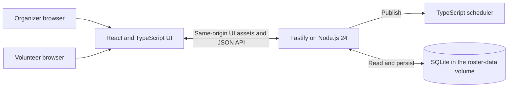

# RosterReady

RosterReady schedules volunteers for one-day events. Organizers create shifts, collect availability through a shared link, and publish a roster. Volunteers can work multiple shifts when the times do not overlap. They use the same link to see their own assignments after publication.

## Run with Docker Compose

```bash
docker compose up --build -d
docker compose ps
```

Open [RosterReady](http://127.0.0.1:3000/) and create an organizer account. SQLite is stored in the Compose `roster-data` volume. Run `docker compose down` to stop the service and keep its data. Set `ROSTER_READY_PORT` before starting if port 3000 is in use.

## Try the sample

Create **Community Workshop** on December 5, 2026 and enter the shifts below. The inputs are also available as a [synthetic fixture](examples/sample-event.json).

| Shift | Time | Volunteers needed |
| --- | --- | --- |
| Setup | 00:55–13:55 | 13 |
| Teacher | 10:55–15:55 | 4 |
| Presentation | 18:15–21:15 | 1 |

1. Copy the volunteer link and open it in a private browsing window. Keep the organizer page open in your regular window.
2. Sign up as **Demo Volunteer**. Select **Teacher** and **Presentation**, then save availability.
3. Publish the roster from the organizer account. It shows **2 of 18 slots filled** and **16 vacancies**.
4. Reopen the shared link in the volunteer session. Both assignments appear under **Your shifts**.

Teacher ends at 15:55 and Presentation starts at 18:15, so the volunteer can fill one slot in each. Setup has no available volunteers. Unpublishing reopens sign-ups and shift editing and keeps saved availability.

## Architecture



Fastify serves the Vite build and the API from one process. SQLite stores accounts, event data, and the published roster. Publishing saves the roster and closes availability in one transaction. The scheduler maximizes filled slots subject to availability, headcounts, and overlapping times. A revision check prevents an old volunteer tab from overwriting a newer availability response.

## Testing

| Test | Result |
| --- | --- |
| `npm test` | 22 Node tests passed, including 1,024 scheduler cases compared with exhaustive search. |
| `npm run build` | TypeScript and Vite build passed. |
| `npm run test:browser` with `ROSTER_READY_BROWSER=chrome` | 6 tests passed, covering the shared-link flow at phone width, stale tabs, and retries after lost event, shift, and sign-up responses. |
| Docker Compose on Linux | The Compose configuration and no-cache build passed, including all 22 Node tests. The roster and volunteer access persisted after container recreation. |
| Physical phone | The volunteer flow was tested on a physical phone over the same Wi-Fi. |

See [test cases](docs/test-cases.md) for manual tests and Docker persistence steps.

<details>
<summary>Run without Docker and use installed Chrome</summary>

Use Node.js 24 and run these commands from the project folder.

```bash
npm ci
npm run build
npm start
```

Open [RosterReady](http://127.0.0.1:3000/). A direct Node start uses `data/roster-ready.sqlite`. In PowerShell, set the browser channel before running the browser suite with installed Chrome.

```powershell
$env:ROSTER_READY_BROWSER = 'chrome'
npm run test:browser
```

</details>

<details>
<summary>Try the sample on a phone over Wi-Fi</summary>

These PowerShell commands use the PC's Wi-Fi IPv4 address on a trusted local network.

```powershell
$env:ROSTER_READY_BIND = (Get-NetIPConfiguration -InterfaceAlias Wi-Fi).IPv4Address[0].IPAddress
$env:ROSTER_READY_PORT = 3100
docker compose up --build -d
```

If the adapter has another name, use that name. Open the app using the PC's Wi-Fi address and port 3100 before copying the event link. Open the copied link on a phone connected to the same Wi-Fi.

</details>

## More documentation

- [Design and usage](<docs/RosterReady Design and Usage.docx>) covers scheduling, architecture, and deployment.
- [AI-assisted development](docs/ai-workflow.md) describes the design decisions, Codex's work, and how the app was tested.
